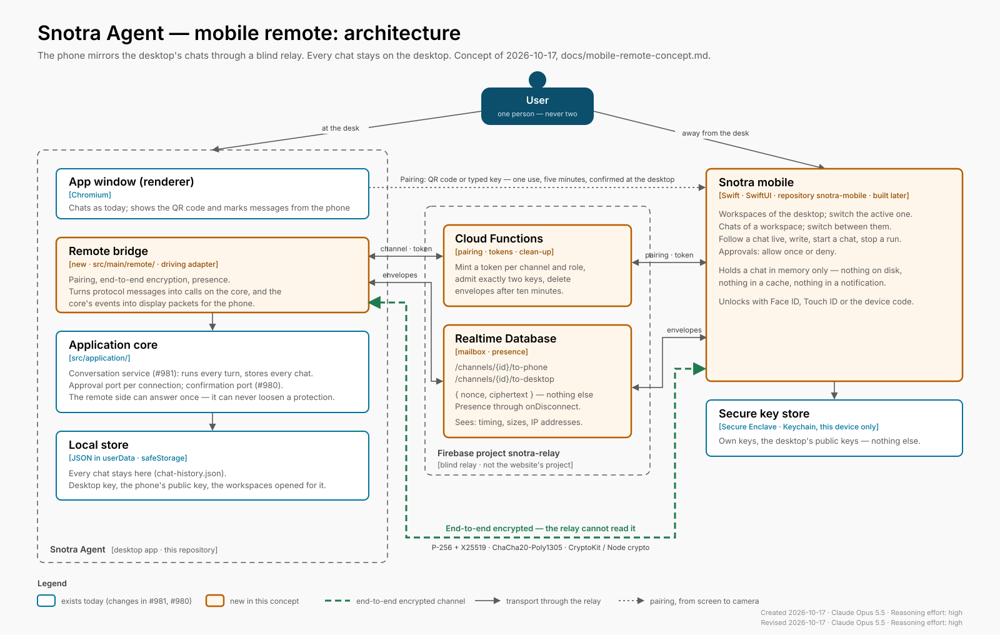

# Mobile remote: a phone as a window into the desktop's chats

Concept, written on 2026-10-17 ([snotra#1082](https://github.com/kkrafft1999/snotra/issues/1082), epic
[snotra#1081](https://github.com/kkrafft1999/snotra/issues/1081)). Nothing of it is built yet. It settles what
the desktop app [Snotra Agent](https://github.com/kkrafft1999/snotra), the relay and this iPhone app have to
agree on before any of them is written, and it is the basis for building the
app. Diagram: [`mobile-remote-architecture.svg`](./mobile-remote-architecture.svg);
the pairing and the channel step by step:
[`remote-pairing-sequence.svg`](https://github.com/kkrafft1999/snotra/blob/main/docs/remote-pairing-sequence.svg) in the Snotra repository.
The bytes — pairing code, the relay's endpoints, `MAC_P`, `MAC_D` and the
safety phrase, with test vectors — are specified in
[`remote-protocol.md`](https://github.com/kkrafft1999/snotra/blob/main/docs/remote-protocol.md);
its §11 lists what this concept took over from it on 2026-10-18.

Moved here from `docs/` of the Snotra repository on 2026-10-17; the history of
the first two versions is in [snotra#1089](https://github.com/kkrafft1999/snotra/pull/1089) and
[snotra#1091](https://github.com/kkrafft1999/snotra/pull/1091). Paths such as `src/…`, `e2e/` or `docs/…`
outside this folder are paths in the Snotra repository, and issue numbers
are Snotra's.

Revised on 2026-10-17, the same day: the app is a native iPhone app in Swift
and SwiftUI, in this repository,
and the encryption is built from CryptoKit on the phone and Node's built-in
`crypto` on the desktop — ChaCha20-Poly1305 instead of XChaCha20, no libsodium
([§5.2](#52-the-channel), [§8](#8-the-mobile-app)).

Revised on 2026-10-18 with the sequence diagram ([snotra#1107](https://github.com/kkrafft1999/snotra/issues/1107)): the outboxes stay
closed until the desktop confirms, the desktop confirms the keys to the phone
with a MAC of its own, and the desktop's presence is a heartbeat
([§4.2](#42-relay-firebase-as-a-mailbox-functions-as-the-door), [§5.1](#51-pairing)).

It changes two decisions of [`quality-requirements.md`](https://github.com/kkrafft1999/snotra/blob/main/docs/quality-requirements.md)
from 2026-10-15 — *no backend of our own* and *remote control over localhost
only* — and the reasons are in [§3](#3-what-changes-in-the-quality-requirements).

## 1. What the user gets

Konrad works at the desktop in one or more workspaces and has to leave the
machine. A chat is still running, or waiting for an approval, or he wants to
ask one more thing. With the phone he can:

- see the workspaces he has opened for remote access, and switch the desktop to
  one of them;
- see the chats of a workspace and switch between them;
- read a chat as it stands on the desktop, and follow a running answer live;
- write a message, start a new chat, stop a run;
- answer a tool approval with *allow once* or *deny*.

The phone is a **mirror**, not a second copy. Every chat stays on the desktop,
is run there and is stored there. The phone holds what is on its screen in
memory and nothing more.

## 2. Ground rules

These are the decisions the rest of the concept follows from. The first five
come from the user, the rest are what they imply.

| # | Rule | Source |
| - | ---- | ------ |
| R1 | **One user.** The phone is a further way in for the person at the desktop, never a second person's. Multi-user operation stays a non-goal and is prevented technically, not only left out. | User, 2026-10-17 |
| R2 | **Chats live on the desktop.** The desktop runs every turn and stores every chat. The phone stores no chat content — not on disk, not in a cache, not in a notification. | User |
| R3 | **Pairing only with what the desktop shows.** A phone joins only by scanning the QR code on the desktop screen, or by typing the key shown next to it. No account, no e-mail link, no code sent elsewhere. | User |
| R4 | **The relay is blind.** The Firebase relay moves end-to-end encrypted packets between exactly two keys and can read none of them. | User (Firebase), decision 2026-10-17 (blind) |
| R5 | **The phone answers approvals once, and never loosens a protection.** *Allow once* and *deny* work from the phone. Auto mode, *always allow*, *allow for this workspace*, a sandbox opt-out, a new program allowance: only at the desktop, in person. | Decision 2026-10-17, [snotra#980](https://github.com/kkrafft1999/snotra/issues/980) |
| R6 | **The phone may switch the desktop's workspace**, but only to one the user opened for remote access, and never in the middle of a run. | Decision 2026-10-17 |
| R7 | **Off by default.** Nothing listens, nothing connects and nothing goes to Firebase until the user pairs a phone. Unpairing removes the channel on the relay. | Privacy goal, §2 of the quality requirements |
| R8 | **No silent state.** The desktop always shows when a phone is connected; the phone always shows whether the desktop is reachable. | "Silent misbehaviour is the worst failure" |

## 3. What changes in the quality requirements

The architecture review agreed on 2026-10-15 that remote control reaches the
core over localhost only, and that Snotra has no server of its own. A relay in
Firebase is a server of ours, and a phone on the mobile network is not on
localhost. Two ways would have kept the old rules:

- **A tunnel the user sets up** (Tailscale, WireGuard, an SSH forward). Keeps
  the rules, but asks for network administration that most users don't do, and
  a phone app that works only behind a VPN is no app.
- **A relay that sees everything** (TLS to Firebase, plain text there). The
  simplest to build — and chats would sit readable on Google's servers.

The decision is the third way: a **blind relay**. It is a backend in the
operational sense — it runs, it costs, it can fail — but not in the sense the
rule was written against: it holds no account, no chat, no key, no telemetry,
and what it stores it cannot read. `quality-requirements.md` is amended to
that effect, with the date, in the same pull request as this concept. Scenario
SEC-5 keeps its localhost rule for the local interface of
[snotra#989](https://github.com/kkrafft1999/snotra/issues/989), and a new scenario
SEC-6 covers the relay.

## 4. The pieces



| Piece | Where it lives | Holds | Does |
| ----- | -------------- | ----- | ---- |
| **Remote bridge** | [Snotra](https://github.com/kkrafft1999/snotra), `src/main/remote/` (driving adapter) and `src/application/` (the parts that decide) | The desktop's identity key (in `safeStorage`), the paired phone's public key, the per-workspace release | Pairing, encryption, translating protocol messages into calls on the conversation service and back; the presence indicator |
| **Relay** | Code in [snotra-promotion](https://github.com/kkrafft1999/snotra-promotion), next to the feedback function; runs in the website's Firebase project `snotra-ai`, with a database and a Functions codebase of its own | Channel records and encrypted envelopes with a short time to live | Pairing endpoints, minting access tokens, carrying envelopes both ways, presence, clean-up |
| **Mobile app** | This repository, `snotra-mobile` — Swift and SwiftUI, iPhone first, implemented later | The phone's identity keys (in the Secure Enclave), the desktop's public keys and the channel id (Keychain, this device only) — nothing else on disk | Shows and drives what the desktop sends |
| **Protocol** | [Snotra](https://github.com/kkrafft1999/snotra): `docs/remote-protocol.md` and `src/shared/contracts/remote/`, with test vectors | — | The contract all three follow, versioned |

Why the protocol lives in the Snotra repository: the desktop is the authority on what a chat is and
what a front end may do. This repository pins a protocol version and runs
the test vectors from there; the relay never needs to understand it.

Why the relay lives in the website's Firebase project: decided by the user on
2026-10-17. The relay belongs on the same Firebase server as the feedback
function, so its code is built in
[snotra-promotion](https://github.com/kkrafft1999/snotra-promotion) and deployed
to that project, `snotra-ai`. The separation this concept first asked for is
kept inside the project instead:

- **Its own database.** The relay uses a Realtime Database instance of its own;
  the website uses Firestore. Each has its own rules.
- **Its own Functions codebase** (`relay`, next to `default` in `firebase.json`),
  deployed on its own with `firebase deploy --only functions:relay`, so a
  website deploy does not redeploy the relay and the other way round.
- **A pinned protocol.** snotra-promotion names one commit of Snotra and tests
  the relay against the protocol's test vectors at that commit. A new protocol
  version reaches the relay through a pull request there that moves the pin
  (decided 2026-10-18,
  [snotra-promotion#165](https://github.com/kkrafft1999/snotra-promotion/issues/165)).
- **A host of its own.** The endpoints live at `relay.snotra-ai.dev`, a Hosting
  site of its own that rewrites `/v1/**` to the `relay` functions. The host is
  written into the QR code and into every app that ships, so it must not change
  with a region or a service name; the website's deploy targets only its own
  site (decided 2026-10-18, snotra-promotion#165).

What stays shared is the project's quota and its bill (§10). It also bends the
rule in
[`task-management.md`](https://github.com/kkrafft1999/snotra/blob/main/.claude/rules/task-management.md)
that nothing in Snotra depends on the website: the desktop's remote feature now
depends on the website's project. That is accepted because the feature is off
by default (R7) and the desktop is unaffected when the relay is down (§6).
Snotra's tests do not bend it: the end-to-end test against the relay runs in
snotra-promotion's CI, and Snotra's own tests use an in-memory relay (§9).

### 4.1 Desktop: the remote bridge is a second front end

The phone is the first front end that is not the renderer. That is exactly the
case three findings of the architecture review were written for, and they are
**prerequisites**, not side work:

- **[snotra#981](https://github.com/kkrafft1999/snotra/issues/981) — the
  conversation moves into the core.** Today the renderer owns the run registry,
  persistence, the cost sum and the title trigger, and sends the whole history
  with every turn. A message from the phone would have to be routed through the
  renderer to become a turn — through a window that may be minimised, reloading
  or showing another chat. The bridge therefore waits for the conversation
  service in `src/application/`: it sends a chat id and a message, and receives
  the same events the renderer receives.
- **[snotra#980](https://github.com/kkrafft1999/snotra/issues/980) — loosening only
  through a confirmation port with user presence.** The remote adapter of that
  port answers every request with *no*. That is R5, enforced by the core rather
  than by the phone app's good manners.
- **[snotra#989](https://github.com/kkrafft1999/snotra/issues/989) — the remote
  interface.** Its channel catalogue (request, response, push and error schemas)
  and the *connection id* that replaces the `webContents` id are what the
  remote protocol is built from. This concept widens [snotra#989](https://github.com/kkrafft1999/snotra/issues/989): the transport is the
  relay, and its threat model has to cover a network attacker, not only a local
  process.

Inside main, the bridge is wired in the composition root like any other driving
adapter. What it needs from the rest of the app:

- **Approvals per connection.** `tool-approval-adapter.js` keeps one
  subscriber per `webContents`. It becomes one subscriber per *connection*, and
  a request goes to every front end that shows its chat — the window and the
  phone. The first answer wins; the other side receives the `resolved` push and
  removes its card. The remote connection is offered only *allow once* and
  *deny*; an *always* that arrives from it anyway is refused in the core.
- **Workspace activation from the phone.** The phone asks; the bridge calls
  `activateKnownFolder` with a path from the release list — never a path the
  phone sends. It is refused while a run in the current workspace is working or
  waiting for an approval (the phone says why). The desktop shows a banner:
  *Switched to "Project X" from your phone.*
- **Events the desktop window shows too.** A message written on the phone
  appears in the desktop's chat as it is sent, with a small phone mark; a chat
  the phone opens does not change the chat on the desktop's screen.
- **Staying awake.** While a phone is connected and a run is working, the
  desktop holds a `powerSaveBlocker` so the machine doesn't sleep mid-answer.
  Beyond that, a sleeping or closed desktop is simply offline (R8).

### 4.2 Relay: Firebase as a mailbox, Functions as the door

A Cloud Function on its own can't carry a conversation: it answers a request
and ends, and two calls of it may land on different instances that know nothing
of each other. The bidirectional channel needs a store both sides listen on.
Three ways to build it:

| Option | How | Cost of a streaming answer | Fit |
| ------ | --- | -------------------------- | --- |
| **A. Realtime Database + Functions** *(recommended)* | Each side writes envelopes into its outbox under `/channels/{id}/` and listens on the other side's. Functions do pairing, tokens and clean-up; both sides keep a heartbeat for their presence. | Billed by data volume, not by writes — a delta every 150 ms is cheap | Best: low latency, presence built in, small free tier is enough for one user |
| B. Firestore + Functions | Same, with documents and snapshot listeners | Billed per write; a streamed answer is hundreds of writes, the free tier runs out after about an hour of streaming a day | Works, costs more, no presence |
| C. Cloud Run with WebSockets | A real relay server holding both sockets | Instance time while connected | Most control, but a server to operate and scale, and two instances still need a broker between them |

**Recommendation: A.** It is the closest to what was asked for — Firebase, a
Function that opens the channel — without asking a Function to do what it
can't. The desktop talks to the database over its REST streaming interface
(server-sent events), so main needs no Firebase SDK — and neither does the
phone, which talks to it the same way (decided 2026-10-22, #33; see §10).
REST has no `onDisconnect`, so each side's presence is a **heartbeat**: while
it is connected it writes `lastSeen` at a fixed interval, and the other side
shows it as offline after three missed beats
([snotra#1227](https://github.com/kkrafft1999/snotra/issues/1227)).

What the relay stores:

```
/channels/{channelId}/meta                         written by the Functions only
    desktopKeys     public keys of the desktop (P-256: signing, key agreement)
    phoneKeys       public keys of the phone, empty until claimed
    macP, macD      key confirmations under the pairing secret (§5.1)
    status          open → pending (claimed) → paired (confirmed)
    createdAt, lastSeen
/channels/{channelId}/handshake/phone              the phone's ephemeral key, handshake 1
/channels/{channelId}/handshake/desktop            the desktop's ephemeral key, handshake 2
/channels/{channelId}/presence/desktop             { lastSeen }, a heartbeat every 30 s
/channels/{channelId}/presence/phone               { lastSeen }, a heartbeat every 30 s
/channels/{channelId}/to-phone/{sid}/{counter}     { c, at }: ciphertext with tag, server time
/channels/{channelId}/to-desktop/{sid}/{counter}   { c, at }
/pairing/{pairingId}                               one claim, 5 minutes
```

The protocol spec is the authority on this layout
([`remote-protocol.md`](https://github.com/kkrafft1999/snotra/blob/main/docs/remote-protocol.md)
§5.10, §12, §13, §15); the concept only sketches it.

- **Access.** No accounts. A Function mints a Firebase custom token whose claims
  name the channel and the role (`desktop` or `phone`), after the caller has
  proved it holds the private key of that role (a signed challenge). The
  security rules keep a token inside its own channel, let it write only into
  its own outbox, and never let it read `/pairing`. Read access is granted
  node by node — `meta` and the four nodes each side follows — never on the
  channel itself: the database's rules are not filters, and read access on the
  channel would reach into both outboxes and echo every envelope back to its
  sender ([snotra#1142](https://github.com/kkrafft1999/snotra/issues/1142)).
- **Closed until paired.** Between its claim and the click at the desktop the
  phone already holds a token, so that it can follow the channel's `meta`.
  In that window the rules let it read `meta` and nothing else;
  both outboxes stay closed until `status` is `paired`, which only the
  confirming Function sets.
- **Two keys, no third.** Once `phoneKeys` are set, the Function refuses another
  claim on the channel. A new pairing creates a new channel and deletes the
  old one (R1).
- **Short life.** The receiver deletes an envelope once it has read it; a
  scheduled Function deletes whatever is older than ten minutes, and channels
  nobody has seen for 30 days.
- **Abuse.** App Check (App Attest) on every call of the phone, enforced in
  production from the start and checked in the Functions' code — not on the
  database, where the desktop cannot attest. Debug tokens exist only in the
  emulator. Further a rate limit per IP, size limits on envelopes, a cap on
  the number of channels and on the Functions' instances during the test
  phase, and a budget alert on the project (§10). None of it protects a chat —
  encryption does — it protects the bill.

What the relay can see is listed in [§6](#6-threat-model).

## 5. Pairing and encryption

### 5.1 Pairing

Pairing joins one phone to one desktop installation. It happens once per
phone, not once per workspace. Every step, with what the relay stores and
when, is drawn in [`remote-pairing-sequence.svg`](https://github.com/kkrafft1999/snotra/blob/main/docs/remote-pairing-sequence.svg).

1. **Desktop.** *Settings › Remote access › Pair a phone.* The desktop creates
   a channel on the relay with its public key and receives a pairing id. It
   draws a QR code and, beneath it, the same content as a typed key:

   ```
   snotra-pair:v1/<relay-host>/0111EP9DZH4QPYT4HWWF
   key: 0111-EP9D-ZH4Q-PYT4-HWWF
   ```

   Twenty Crockford base32 symbols: a 20-bit pairing id the relay minted, a
   **75-bit pairing secret** from the desktop's random generator, and a check
   symbol that lets the phone catch a typo before it asks the relay. The code
   is valid for **five minutes and one use**; the secret never reaches the
   relay. 75 bits rather than 128 so that id and secret fit the twenty symbols
   of the typed key — the secret only has to hold for those five minutes
   against an offline search ([spec §4](https://github.com/kkrafft1999/snotra/blob/main/docs/remote-protocol.md#4-the-pairing-code), decided
   2026-10-18). The phone accepts a QR code only for a relay host it ships with.
2. **Phone.** Scans the code or takes the typed key. It generates its own
   keys in the Secure Enclave and sends the public halves to the pairing
   endpoint, together with `MAC_P`, an HMAC-SHA256 under the pairing secret
   over the label `phone`, its own and the desktop's public keys. The relay
   stores them, refuses any further claim, and cannot forge the MAC: it
   doesn't know the secret. The channel stays `pending`, its outboxes closed.
3. **Desktop.** Checks `MAC_P`. A wrong MAC — a relay or a stranger trying to
   slip in its own keys — ends the pairing with an error.
4. **Both** derive the same six-word safety phrase from both sides' public keys
   and show it. The words come from one fixed list that belongs to the protocol
   (`docs/remote-protocol.md`, with test vectors) and are never translated: a
   desktop in German and a phone in English show the same six words.
5. **Desktop, in person.** *"iPhone wants to access Snotra. The phone shows:
   coffeecake · groundhog · maestro · kangaroo · ozone · oncoming. Allow?"* Only this click
   completes the pairing. A photographed QR code is therefore not enough: it
   needs someone at the desktop to confirm it within five minutes. The question
   is a native sheet on the app window, asked through the confirmation port of
   [snotra#980](https://github.com/kkrafft1999/snotra/issues/980): *Deny* is the
   default answer, and neither the renderer nor the phone can answer it.
   *Settings › Remote access* shows the six words large beside it for comparing
   ([mockup](https://github.com/kkrafft1999/snotra/blob/main/docs/ui-design/remote-access-mockup.html)).
6. **Desktop → phone.** With the confirmation the desktop sends `MAC_D`, the
   same HMAC over the label `desktop` and both sides' keys, and the relay sets
   the channel to `paired`. The phone checks `MAC_D` before it keeps the
   desktop's keys. Both sides now know from the pairing secret alone that they
   hold each other's real keys; for the phone, too, the safety phrase is a
   second, human check and no longer the only one. The labels keep one MAC
   from being passed off as the other.

From then on the phone authenticates with its key; there is no password to
lose and no code to reuse.

Opening workspaces for the phone is a separate switch per workspace —
*Settings › Tools & security › Access from your phone* — so a workspace with
sensitive material can stay invisible to the phone even when another one is
open. The first time the switch is turned on without a paired phone, it leads
into the pairing above. That keeps the gesture as it was imagined — connect the
phone to this workspace — while the phone only has to be scanned once.

### 5.2 The channel

- **Identity.** Each side holds two long-term P-256 keys: one to sign (it
  proves the role to the relay's token Function) and one for key agreement.
  On the phone both live in the **Secure Enclave** and cannot be exported; on
  the desktop they are stored through `safeStorage`. P-256 rather than
  Curve25519 for these, because the Secure Enclave knows only P-256.
- **Session keys.** Every connection starts with a fresh X25519 pair on each
  side. HKDF-SHA256 mixes the static P-256 agreement (who is talking) with the
  ephemeral X25519 agreement (forward secrecy) and the handshake transcript,
  and derives one key per direction. A stolen long-term key does not decrypt
  past connections.
- **Packets.** ChaCha20-Poly1305 in its IETF form with a 96-bit nonce: a
  64-bit per-direction counter, padded. Since every connection and direction
  has its own key, a nonce never repeats under a key — the reason XChaCha20's
  random 192-bit nonces aren't needed. A packet that is replayed, reordered
  beyond a small window, or altered is dropped, and the connection is
  re-established.
- **Libraries.** None from third parties: **CryptoKit** on the phone
  (`P256.Signing`, `SecureEnclave.P256.KeyAgreement`, `Curve25519.KeyAgreement`,
  `HKDF`, `ChaChaPoly`), Node's built-in **`crypto`** in main (`ecdh`/`sign`
  on `prime256v1`, `x25519`, `hkdf`, `chacha20-poly1305`). Both are covered by
  the shared test vectors of the protocol. Checked against the Noise `KK`
  pattern as planned: it cannot be written as Noise, because `KK`'s mixed
  agreements need long-term and ephemeral keys on one curve, and the Secure
  Enclave knows only P-256. The handshake keeps `KK`'s static and ephemeral
  agreements and gives up resistance to key-compromise impersonation, which
  only a compromised desktop could exploit ([spec §19](https://github.com/kkrafft1999/snotra/blob/main/docs/remote-protocol.md#19-why-not-noise-kk)).
- **Specified** in [the protocol spec](https://github.com/kkrafft1999/snotra/blob/main/docs/remote-protocol.md#12-connecting), §12–§18
  (snotra#1113): the handshake in two records under `/handshake/`, envelopes
  under `/to-desktop|to-phone/{sid}/{counter}`, `session.hello` as key
  confirmation, the receiver's order rule, with test vectors.
- **Version.** Handshake 1 names the versions the phone speaks; a version the
  desktop doesn't speak ends the connection with a message the phone can show.

### 5.3 Ending it

- *Settings › Remote access › Remove phone* deletes the phone's key on the
  desktop and the channel on the relay. The phone loses access immediately.
- Pairing a new phone removes the old one (R1). The desktop says so before it
  starts.
- The app on the phone has *Disconnect*, which deletes its keys.
- A channel unused for 30 days is deleted on the relay; the desktop then shows
  the phone as removed.

## 6. Threat model

The attacker model of [`security-concept.md`](https://github.com/kkrafft1999/snotra/blob/main/docs/security-concept.md) §5 puts
local processes outside the goal. The relay adds a network attacker, and the
operator of the relay — Google, or whoever gets into the Firebase project.

| Threat | What stops it |
| ------ | ------------- |
| The relay, or someone inside the Firebase project, reads chats | End-to-end encryption; the relay never holds a private key or the pairing secret |
| The relay injects or alters messages | AEAD with counters; a forged packet doesn't authenticate |
| The relay swaps in its own key during pairing | `MAC_P`, checked by the desktop, and `MAC_D`, checked by the phone, both under the pairing secret; then the safety phrase confirmed at the desktop |
| Someone photographs the QR code | One use, five minutes, and the pairing completes only with a click at the desktop |
| **A second person uses Snotra through the phone** (R1) | One phone per installation; a new pairing removes the old one; the channel admits exactly two keys; pairing needs presence at the desktop |
| A stolen or lost phone | *Remove phone* at the desktop; the app asks for Face ID / Touch ID / the device code when it opens and after 5 minutes in the background |
| The phone loosens a protection | Not offered, and refused in the core ([snotra#980](https://github.com/kkrafft1999/snotra/issues/980)); only *allow once* / *deny* |
| The phone reaches files outside a released workspace | The phone sends ids, never paths; activation only from the release list; the workspace stays the trust boundary of [snotra#68](https://github.com/kkrafft1999/snotra/issues/68) |
| A prompt injection in a chat reaches the phone | The phone renders Markdown with the same sanitizing rules as the desktop, no remote images, no HTML |
| Chat content left on the phone | Memory only; a shield covers the app while it is not active, so the app switcher snapshot shows nothing; no content in notifications; Keychain entries are `…ThisDeviceOnly` (§8) |
| Chat content leaving the phone through the screen | The same shield covers the app while the screen is recorded, mirrored or shared ([#27](https://github.com/kkrafft1999/snotra-mobile/issues/27)); a screenshot cannot be prevented |
| A keyboard sends what is typed to its maker | Third-party keyboards are refused app-wide; only the system keyboard and dictation remain (#27) |
| The relay is down | The desktop is unaffected — the remote feature is off until it comes back, and the phone says so |
| Abuse of the relay, a large bill | App Check, rate limits, envelope size limits, TTL clean-up, a cap on channels and instances, budget alert; before the remote goes public a kill switch for the relay alone ([snotra-promotion#166](https://github.com/kkrafft1999/snotra-promotion/issues/166)) |

**What the relay does see**, and the privacy notice of the app has to say so:
that a channel exists; when each side is online; the time and size of every
packet; the IP addresses of desktop and phone. From the sizes and the timing it
can guess *that* a long answer is streaming, never *what* it says.

## 7. The protocol

Specified in detail in `docs/remote-protocol.md` once
[snotra#989](https://github.com/kkrafft1999/snotra/issues/989) has settled the
channel catalogue. The shape, as far as this concept needs it:

**Phone → desktop**

| Message | What it does |
| ------- | ------------ |
| `hello` | Protocol version, app version, language of the phone |
| `workspaces.list` | The released workspaces, which one is active |
| `workspace.activate` | Switch the desktop to a released workspace (R6) |
| `chats.list` | Chats of the active workspace: id, title, time, running/needs approval |
| `chat.open` | Subscribe to one chat; the answer is a snapshot of its last 30 messages |
| `chat.more` | Older messages, page by page |
| `chat.new` | A new chat in the active workspace |
| `message.send` | A message into a chat — becomes a turn on the desktop |
| `run.abort` | Stop the chat's run |
| `approval.respond` | `allow-once` or `deny` for a pending request |

**Desktop → phone**

| Message | What it says |
| ------- | ------------ |
| `state` | Active workspace, running chats, whether the desktop is busy |
| `chat.snapshot` | Messages as display DTOs — Markdown text, tool lines already formatted by `shared/presentation/tool-display.js`, no raw tool payloads |
| `chat.delta` | Streamed text, batched every 150 ms into one packet |
| `chat.tool-line`, `chat.progress`, `chat.run-end` | As the renderer gets them (see *Runs per chat* in [`architecture.md`](https://github.com/kkrafft1999/snotra/blob/main/docs/architecture.md#runs-per-chat-320)) |
| `approval.request`, `approval.resolved` | The same card the desktop shows, with the options the phone may use |
| `error` | An error key from the catalogue (`src/shared/i18n/`), translated on the phone |

Two rules carry the rest:

- **The phone sends ids, the desktop decides.** No path, no tool payload, no
  setting reaches the desktop from the phone — with one exception: a chat's
  reasoning level (`chat.setReasoning`, snotra#1304), one of the levels the
  desktop listed for that chat. It grants nothing; it only changes a turn's
  depth and cost. Model, mode, skills and tools stay with the desktop.
- **The desktop sends what it would show, not what it holds.** Display DTOs,
  like the renderer receives — the phone needs no provider knowledge and no
  history to resend.

Images and attachments in a chat are left out of the first version; the
snapshot carries a placeholder (*Image — open on the desktop*). They can follow
as encrypted, size-capped thumbnails on demand.

## 8. The mobile app

Built later, in this repository. What this concept asks of it:

- **Screens:** pairing (camera, typed key, safety phrase), workspaces, chats of
  a workspace, a chat with composer and approval cards, connection state.
- **Stores nothing but its keys.** No chat in a database, a file or a cache;
  everything is gone when the app is closed.
- **Keychain on this device only** (#27). Everything the app keeps in the
  Keychain — the desktop's public keys, the channel id, the references to its
  Secure Enclave keys — uses `kSecAttrAccessibleWhenUnlockedThisDeviceOnly`:
  never in iCloud Keychain, never in a backup, unreadable while the phone is
  locked. The Secure Enclave keys are bound to the device by nature.
- **Names the word list.** The safety phrase uses the EFF short word list 2.0
  (CC BY 3.0 US); the About screen credits the Electronic Frontier Foundation
  with a link to the licence, as Snotra's `THIRD_PARTY_NOTICES.md` does.
- **Bilingual**, English and German, under the rules of
  [`language.md`](https://github.com/kkrafft1999/snotra/blob/main/.claude/rules/language.md).
- **Same standard** as the desktop under
  [`ux-ui-standards.md`](https://github.com/kkrafft1999/snotra/blob/main/.claude/rules/ux-ui-standards.md): every state —
  desktop offline, relay unreachable, workspace not released, run waiting for
  approval, approval answered on the desktop — has its own screen or note.
- **Platform: iPhone, native** (decided 2026-10-17). Swift and SwiftUI, with
  what the system brings: CryptoKit and the Secure Enclave for the keys,
  VisionKit (`DataScannerViewController`) for the QR scan, LocalAuthentication
  for Face ID, URLSession for the relay and its Realtime Database. React Native
  with Expo was the alternative — one language with the desktop and Android
  almost for free — and lost on the two things the concept rests on: the
  encryption comes from the platform instead of a third-party binding, and the
  app looks and behaves like an iPhone app. Android is not planned; the
  protocol does not depend on the platform, so it stays possible.
- **iOS 26 at least** (decided 2026-10-20, #27). Devices that stop at iOS 18,
  such as the iPhone XS and XR, no longer receive the full security updates,
  and a phone that drives an agent on the desktop should not be one of them.
  It also lets the app use the system's newer APIs without a fallback.
- **Building it needs Xcode** on the Mac (not installed as of 2026-10-17) and
  the Apple Developer Program for TestFlight and the user's own iPhone.

**Push notifications** — *"Snotra needs your approval"* while the app is closed
— are a sensible second step, not part of the first. They need FCM/APNs, which
adds metadata at Google or Apple. They would carry no content at all: the
desktop pings the relay, a Function sends an empty "open the app" notification,
the app fetches the actual card over the channel.

## 9. Phases

| Phase | What | Where | Depends on |
| ----- | ---- | ----- | ---------- |
| 0 | Conversation in the core ([snotra#981](https://github.com/kkrafft1999/snotra/issues/981)), confirmation port ([snotra#980](https://github.com/kkrafft1999/snotra/issues/980)), remote interface ADR widened to the relay ([snotra#989](https://github.com/kkrafft1999/snotra/issues/989)) | Snotra | — |
| 1 | Protocol spec and test vectors; remote bridge with pairing, encryption, presence; desktop UI (*Settings › Remote access*, workspace switch, connection indicator, phone mark on messages) | Snotra | 0 |
| 2 | Relay: Realtime Database instance, Functions codebase, database rules, clean-up; tested against the Firebase emulator and the test vectors of a pinned Snotra commit ([snotra-promotion#165](https://github.com/kkrafft1999/snotra-promotion/issues/165)) | snotra-promotion | 1 (protocol) |
| 3 | A small reference client in Node in Snotra's `e2e/` that pairs and chats through the relay — the desktop's end-to-end test, and the mobile app's reference ([snotra#1135](https://github.com/kkrafft1999/snotra/issues/1135)). It runs in snotra-promotion's CI against the emulator, at the pinned commit; Snotra tests it against a stand-in | Snotra (code), snotra-promotion (run) | 1, 2 |
| 4 | Mobile app MVP | this repository | 1–3 |
| 5 | Push notifications, images | all | 4 |

Phase 3 matters: it lets the desktop side be finished and tested before a
single line of the mobile app exists, and gives that app a client to compare
against.

## 10. Decisions and open points

Decided on 2026-10-17:

- **The relay's code** is built in
  [snotra-promotion](https://github.com/kkrafft1999/snotra-promotion) and runs in
  its Firebase project, next to the feedback function (§4).
- **One device per desktop installation.** A Snotra desktop installation can
  have exactly one paired device, never a second one alongside it (say a phone
  and a tablet). The picture is one person who works at the desktop and, away
  from it, reaches that desktop from one phone. A new pairing replaces the old
  one (R1, §5).
- **Privacy notice** on the snotra-promotion website, once the relay is live,
  listing what §6 says the relay sees.
- **Cost ceiling: USD 100 over ten months, at most USD 10 a month.** It is set
  up as a monthly budget of USD 10 on the Firebase project. Because the project
  is shared, the budget covers the website and the relay together, and reaching
  it raises an alert — it does not stop anything. A hard stop would take the
  website down with the relay, so there is none for now. *Amended on
  2026-10-18:* EUR instead of USD, with early alerts, and a stop for the relay
  alone before the remote goes public — see below.

Decided on 2026-10-18, with the sequence diagram
([snotra#1107](https://github.com/kkrafft1999/snotra/issues/1107)):

- **One device stays.** *Settings › Remote access* holds no list of
  connections; pairing a new phone replaces the paired one (§5.3).
- **Outboxes closed until paired.** The phone's token between claim and
  confirmation reads the channel's `status` and nothing else (§4.2).
- **Key confirmation both ways.** The desktop sends `MAC_D` with its
  confirmation and the phone checks it (§5.1, step 6).
- **Heartbeat for the desktop's presence**, because REST streaming has no
  `onDisconnect`. The Firebase JS SDK in main would have brought it, at the
  price of a large dependency for one flag (§4.2).
- **The pairing dialog.** It runs inside *Settings › Remote access* — no dialog
  of its own on top of the settings — and *Allow* is the confirmation port's
  native sheet, not a button in the window (§5.1, step 5; layout A of the
  [mockup](https://github.com/kkrafft1999/snotra/blob/main/docs/ui-design/remote-access-mockup.html)).
- **One word list in every language** for the safety phrase (§5.1, step 4):
  the **EFF short word list 2.0**, 1,296 words with a unique three-letter
  prefix each, in Snotra's `src/shared/contracts/remote/safety-words-v1.json`
  ([spec §7](https://github.com/kkrafft1999/snotra/blob/main/docs/remote-protocol.md#7-the-safety-phrase); snotra#1116).
- **A 75-bit pairing secret** in a twenty-symbol code instead of 128 bits
  (§5.1, step 1; [spec §4](https://github.com/kkrafft1999/snotra/blob/main/docs/remote-protocol.md#4-the-pairing-code)).

Decided on 2026-10-18, with
[snotra-promotion#165](https://github.com/kkrafft1999/snotra-promotion/issues/165)
(options 1A + 2A there):

- **The relay pins the protocol.** snotra-promotion names one commit of Snotra
  and tests the relay against the test vectors at that commit; moving the pin
  is a pull request there (§4).
- **The end-to-end test runs at the relay.** The reference client is written in
  Snotra ([snotra#1135](https://github.com/kkrafft1999/snotra/issues/1135)), but
  snotra-promotion's CI checks Snotra out at the pinned commit and runs it
  against the emulator. Nothing in Snotra points at the website repository,
  and Snotra's three test jobs need neither Java nor `firebase-tools` (§9).
- **The relay's host** is `relay.snotra-ai.dev`, a Hosting site of its own
  (§4).
- **App Check is enforced from the start**, in the Functions' code and not on
  the database; debug tokens only in the emulator. The iOS simulator works
  against the emulator, real devices use App Attest against production (§4.2).
- **The budget for the test phase** is 10 EUR a month — the billing account
  bills in EUR — with alerts at 1, 5 and 10 EUR and a forecast alert. Since
  the expected cost of a few testers is nil, the first euro already counts as
  a sign of a bug. Hard limits sit inside the relay: a cap on channels
  (proposal: 25) and on the Functions' instances. Before the remote goes
  public, a kill switch turns off the relay alone when the budget is reached,
  leaving the website up
  ([snotra-promotion#166](https://github.com/kkrafft1999/snotra-promotion/issues/166)).

Decided on 2026-10-22, with #33:

- **No Firebase SDK on the phone either.** The app reaches the relay like the
  desktop: the endpoints over HTTPS, custom token → ID token through the
  Identity Toolkit, the database by REST and server-sent events. Firebase Auth
  on iOS keeps its signed-in user in the Keychain and has no in-memory mode,
  which would break "refresh tokens in memory only" (spec §12) and an app that
  keeps nothing but its keys. The price is `onDisconnect`: the phone's
  presence becomes a heartbeat like the desktop's
  ([snotra#1227](https://github.com/kkrafft1999/snotra/issues/1227)), and the
  app brings its own stream reader instead of the SDK's.
- **App Check without the SDK, too** (#51). The app keeps one App Attest key
  per installation, attests it once through App Check's REST API
  (`exchangeAppAttestAttestation`) and gets every later token by assertion
  (`exchangeAppAttestAssertion`). Only `lookup` and `claim` carry a token:
  `lookup` a reusable one, `claim` a limited-use one, which the relay
  consumes. Debug builds keep the emulator's fixed value; a release build has
  no such path.

Still open:

- **How many messages go over the relay.** The user base is small and the app
  is in testing; the numbers from that phase decide whether the budget holds.
- **A paid upgrade.** If the relay's cost grows, the remote feature may later
  become part of a paid upgrade. Not decided yet.
- **What the desktop does on a phone message while the user sits in front of
  it** — nothing special is planned; the message appears in the chat with its
  phone mark.
